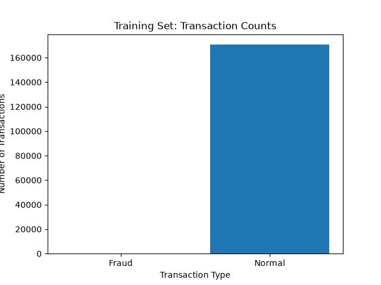
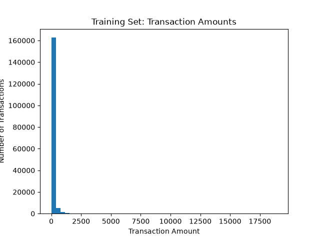
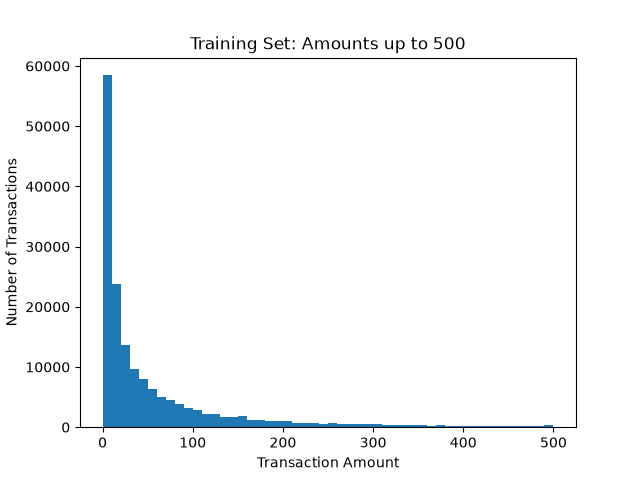
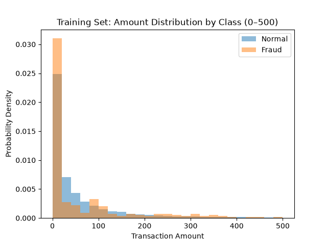
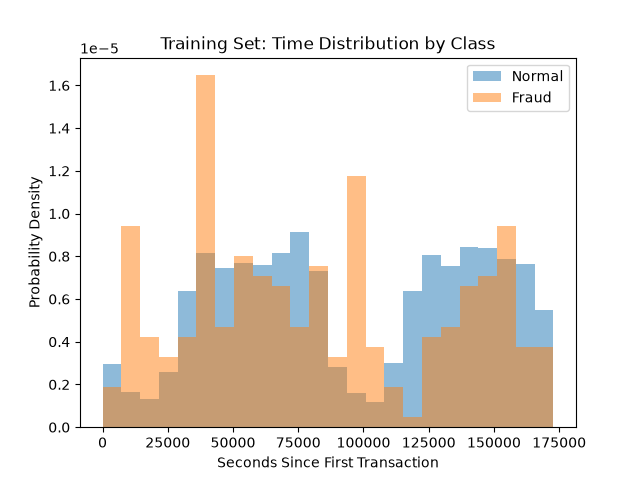
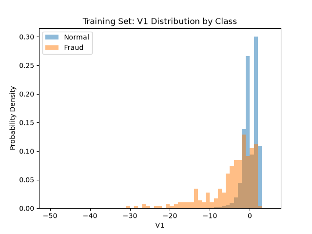
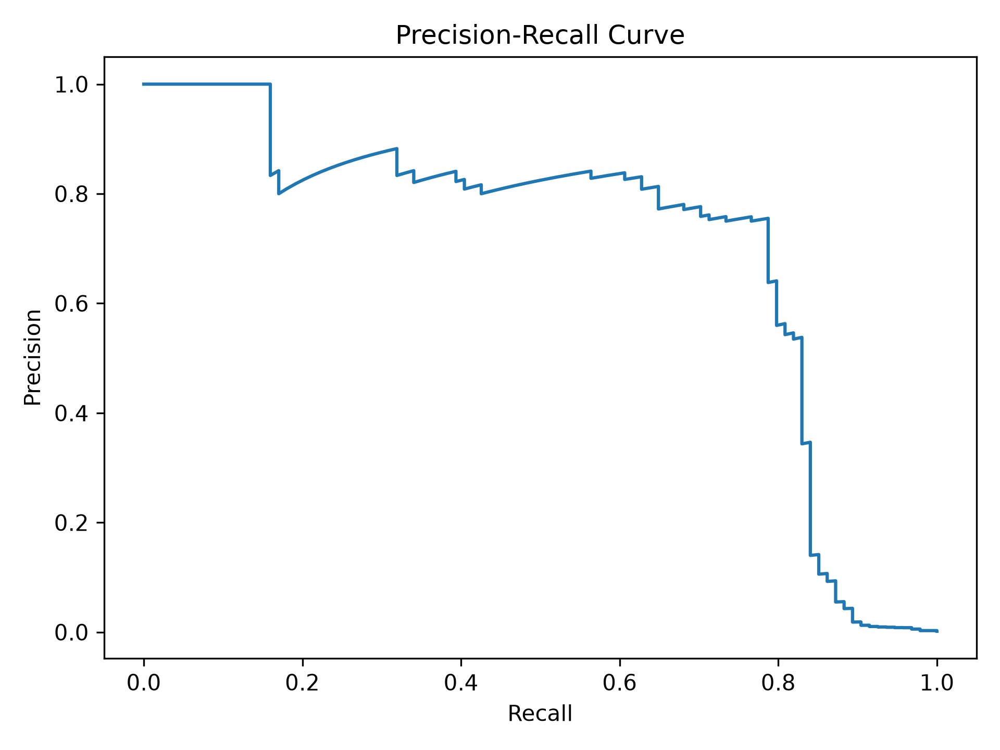
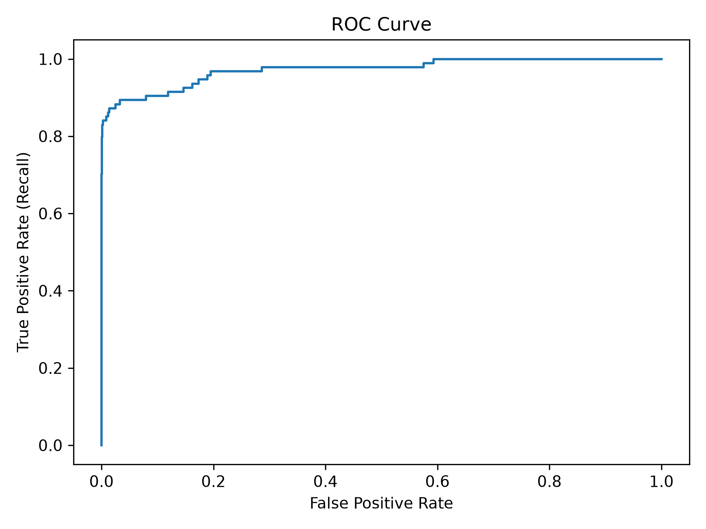

# Credit Card Fraud Detection

## Goal

Use the ULB credit card transaction dataset to explore data, prepare features, train models, evaluate performance, and present findings. Days 1–2 data inspection and exploratory analysis are complete in `data_review.py`. Days 3–6 training, model comparison, threshold selection, and final test evaluation are complete in `train_model.py`. Dataset findings and model results are reported separately below. The executed notebook, portable scripts, and aggregate result tables provide a reproducible first version. Repository: [SunDazhi0117/credit-card-fraud](https://github.com/SunDazhi0117/credit-card-fraud).

## Learning Progress

Follow the [seven-day plan](SEVEN_DAY_PLAN.md), which includes the current progress and next-session starting point.

- [x] Create the project directory
- [x] Install and verify Python
- [x] Create a project virtual environment and install pandas
- [x] Install the core dependencies used by the analysis and training scripts
- [x] Practice the Python and pandas basics needed for Day 1
- [x] Download the dataset and inspect its structure
- [x] Complete exploratory data analysis
- [x] Split the data into training, validation, and test sets
- [x] Train an always-normal baseline and ordinary logistic regression with a scaling Pipeline
- [x] Evaluate ordinary logistic regression on validation data and save PR/ROC curves
- [x] Train class-weighted logistic regression
- [x] Compare ordinary and class-weighted logistic regression with random forest
- [x] Select a model and threshold on validation data, evaluate on test data, and write conclusions
- [x] Prepare the local GitHub repository and project presentation
- [x] Publish the repository to GitHub

## Experiment Guidelines

Split the data before fitting preprocessing steps such as scaling. Fit these steps only on training data to avoid data leakage. Use a Pipeline to keep preprocessing consistent between training and prediction.

Use the validation set to select models and decision thresholds, then evaluate on the test set at the end. In addition to accuracy, focus on fraud-class precision, recall, F1, the confusion matrix, and Average Precision (AP). Plot both PR and ROC curves.

Apply any resampling only to training data. Record actual results after running experiments; do not write conclusions in advance.

## Directory Structure

```text
credit-card-fraud/
├── data/README.md                  # Download instructions; CSV excluded
├── data_review.py                  # Original training-set EDA
├── train_model.py                  # Fixed modeling and evaluation workflow
├── notebooks/fraud_detection.ipynb # Executed report, runs the two scripts
├── images/                        # Six EDA plots and two LR validation curves
├── results/                       # Aggregate CSV evaluation tables
├── requirements.txt
├── PROJECT_PRESENTATION.md         # English introduction and Chinese study notes
├── SEVEN_DAY_PLAN.md
└── .gitignore
```

## Reproduce Locally

Use Python 3.13 (the original environment uses 3.13.15). Download or clone this repository, then open a terminal in its root directory. On macOS/Linux:

```bash
python3 -m venv .venv
source .venv/bin/activate
python -m pip install -r requirements.txt
```

On Windows, create the environment with `py -3.13 -m venv .venv` and activate it with `.venv\Scripts\Activate.ps1` in PowerShell. Then use the same pip command.

Download the CSV following [data/README.md](data/README.md). Run:

```bash
python data_review.py
python train_model.py
```

Scripts locate data relative to their own files and create `images/` if needed. Plot windows may need closing before execution continues. For a non-interactive run on macOS/Linux:

```bash
MPLBACKEND=Agg python data_review.py
MPLBACKEND=Agg python train_model.py
```

Open [the notebook](notebooks/fraud_detection.ipynb) in VS Code with Python/Jupyter support, select `.venv/bin/python` (Windows: `.venv\Scripts\python.exe`) as its kernel, and Run All from the project or notebooks directory. The notebook runs both scripts, embeds their saved figures, and exports four aggregate tables to `results/`. It retrains all fixed models and may take several minutes. Reading its saved outputs does not require execution.

This is a research/learning project, not a deployed prediction service. No model artifact or web application is provided. Reproduction reruns must not guide new choices using the already-exposed test set. Pinned packages record the working environment, not a guarantee of identical results on every platform.

## Dataset Overview

The dataset contains 284,807 transactions and 31 columns. Of these transactions, 492 are fraudulent and 284,315 are legitimate. Fraud accounts for approximately 0.173% of all transactions, indicating severe class imbalance. The initial checks detected no pandas-recognized missing values in any column; this does not establish that the dataset is free of other quality issues.

Transaction amounts have a mean of approximately 88.35, a median of 22.00, and a maximum of 25,691.16. These summaries suggest a right-skewed distribution, supported by the training-set histograms. Large amounts alone do not establish fraud or data errors.

An always-legitimate prediction would achieve approximately 99.827% accuracy on this full dataset while detecting none of the fraudulent transactions. This illustrates why accuracy alone is insufficient for this task; it is a direct calculation, not a trained-model evaluation.

### Fields and Prediction Target

- `Time`: elapsed seconds since the first transaction in the dataset, not a known clock time.
- `V1`–`V28`: PCA-transformed numerical features whose original business meanings are not disclosed.
- `Amount`: transaction amount.
- `Class`: observed label, with 0 indicating a legitimate transaction and 1 indicating fraud.

The 30 non-label columns are candidate model inputs. `Class` is the prediction target and must not be included among the input features.

### Run the Analysis Script

```bash
python data_review.py
```

Run from the project root after following the setup instructions above. The notebook also runs this script and displays its figures.

## Day 2: Exploratory Data Analysis

Detailed EDA uses the training set. Two stratified splits with `random_state=5` produce 170,884 training rows (295 fraud), 56,961 validation rows (98 fraud), and 56,962 test rows (99 fraud). These approximately 60/20/20 splits reserve validation data for model selection and test data for final evaluation. They are random splits, not a simulation of predicting future transactions; the exact-duplicate audit and revised modeling split are described in Day 3 below. Broader dependencies between transactions remain unaudited.

### Class Imbalance

Only about 0.173% of training transactions are fraudulent. Raw class counts are strongly unequal.



### Transaction Amounts

Training amounts are strongly right-skewed, with many small transactions and a long tail of large values. The 0–500 view reveals detail hidden by the full range; it excludes larger amounts from the plot, not from the training data.





Normal transactions have mean amount 87.91 and median 22.00; fraudulent transactions have mean 118.62 and median 7.57. A higher fraud mean therefore does not imply that most fraudulent transactions are larger. Within the displayed 0–500 range, fraud is more concentrated in the first 0–20 bin. Each class histogram is normalized separately within that range: areas represent within-class proportions, not fraud probabilities or raw counts.



### Elapsed Time

Training Time ranges from 0 to 172,788 seconds, approximately 48 hours. Using shared two-hour bins, the learner did not observe a clear visual separation of the classes. This does not establish that Time has no predictive value. Only 295 training fraud cases are available, and bin choices affect the appearance. Time is elapsed time, not a known clock hour.



### Example PCA Feature: V1

V1 was selected as an introductory example, not through feature ranking. Fraud has a lower median (-2.63 versus 0.02) and mean (-4.50 versus 0.01), but distributions overlap. Very negative values are not exclusive to fraud: the normal minimum is -46.86 versus -30.55 for fraud. The feature's original business meaning is not disclosed. These descriptive observations do not establish a classification rule, causal relationship, or model performance.



## Day 3: Duplicate Handling and Initial Baseline

`train_model.py` removes 1,081 exact duplicate rows (all 31 columns) in memory before applying the stratified 60/20/20 split with random seed 5. This leaves 283,726 records. Deduplication is a modeling choice to reduce overlap, not proof that repeated records are erroneous; the raw CSV is unchanged. Matching on all columns does not audit every possible dependency or feature-only match.

The new training set has 170,235 rows and validation has 56,745. The training/validation exact-row overlap check returns zero. An always-normal DummyClassifier achieves 99.83435% validation accuracy, correctly classifying 56,651 records while missing all 94 fraud cases. Ordinary logistic regression has now been trained and evaluated as described below. The test set was held out during model selection; its final evaluation is recorded under Day 6.

The Day 1/2 figures and statistics above still describe the original data and original split used by `data_review.py`. They must not be presented as results for the deduplicated modeling split.

## Days 3–4: Logistic Regression and Validation Evaluation

A Pipeline combines `StandardScaler` and `LogisticRegression(max_iter=1000)`. Scaling parameters and classifier parameters are fitted only on the training set. Prediction methods receive raw validation features and apply the fitted scaler automatically. All 30 non-label columns are used. The Pipeline refactor was checked against the previous separate scaler/model workflow: predicted labels match exactly, and probabilities match within numerical tolerance.

The validation set contains 56,745 transactions, including 94 fraud cases. These are validation results, not final held-out test results. Precision, recall, F1, and confusion counts use the classifier's default prediction rule; AP and ROC-AUC use fraud probabilities across thresholds.

| Metric | Ordinary logistic regression |
| --- | ---: |
| Precision | 0.828571 |
| Recall | 0.617021 |
| F1 | 0.707317 |
| Average Precision (AP) | 0.707318 |
| ROC-AUC | 0.972034 |

| Actual / Predicted | Normal (0) | Fraud (1) |
| --- | ---: | ---: |
| Normal (0) | 56,639 (TN) | 12 (FP) |
| Fraud (1) | 36 (FN) | 58 (TP) |

The model raises 70 alerts: 58 are correct and 12 are false alarms. It detects 58 of 94 fraud cases and misses 36. The always-normal baseline misses all 94 despite 99.83435% accuracy. ROC-AUC indicates overall ranking ability, not the percentage of fraud detected. AP summarizes precision–recall performance and is not interchangeable with trapezoidal PR area; its numerical similarity to F1 here is coincidental. These metrics do not establish probability calibration or production readiness.





Run the current local training script:

```bash
python train_model.py
```

The script saves both curves in `images/` and displays them. Dataset and image paths are resolved from the script location. The notebook includes the same workflow and saved outputs.

The Day 5 comparison is recorded below, followed by Day 6 threshold selection and final held-out test results.

## Day 5: Model Comparison

All three models use the same training and validation splits. Both logistic regressions use a StandardScaler Pipeline and max_iter=1000; the weighted version adds class_weight="balanced". RandomForestClassifier uses 100 trees, random_state=5, n_jobs=-1, no class weighting, and unscaled features. Counts and threshold-dependent metrics use each estimator's default predict method. Results below come from the completed script run reported on 2026-10-17.

| Validation metric | Ordinary logistic regression | Balanced logistic regression | Random forest |
| --- | ---: | ---: | ---: |
| True positives | 58 | 83 | 73 |
| False positives | 12 | 1,158 | 10 |
| False negatives | 36 | 11 | 21 |
| True negatives | 56,639 | 55,493 | 56,641 |
| Precision | 0.828571 | 0.066882 | 0.879518 |
| Recall | 0.617021 | 0.882979 | 0.776596 |
| F1 | 0.707317 | 0.124345 | 0.824859 |
| Average Precision | 0.707318 | 0.672268 | 0.825314 |
| ROC-AUC | 0.972034 | 0.976941 | 0.950411 |

At the default prediction rules, weighting detects 25 more fraud cases than ordinary logistic regression but generates 1,146 additional false alarms. Random forest detects 15 more fraud cases than ordinary logistic regression while producing two fewer false alarms. It has the highest validation precision, F1, and AP among these candidates; balanced logistic regression has the highest recall and ROC-AUC.

Random forest's lower ROC-AUC despite higher AP is not contradictory: the metrics summarize different aspects of the score ordering. ROC-AUC measures pairwise discrimination across all fraud/normal pairs, while AP summarizes precision as recall increases. With extreme class imbalance, a low false-positive rate can still correspond to many false alerts. No single metric establishes a universally best model.

These are comparisons on one validation split, not evidence of statistically significant superiority. Day 6 records the subsequent threshold selection and test evaluation. Business costs have not been estimated. The PR/ROC figures above still describe ordinary logistic regression only.


## Day 6: Threshold Selection and Final Test Results

### Validation Selection

We compared thresholds 0.2, 0.3, and 0.5 for each of the three trained models, predicting fraud when its score was greater than or equal to the threshold. The selection criterion was the highest validation F1 among these nine candidates. This is an educational selection rule, not an estimate of the most profitable banking policy.

| Model | Threshold | TP | FP | FN | Precision | Recall | F1 |
| --- | ---: | ---: | ---: | ---: | ---: | ---: | ---: |
| Logistic regression | 0.2 | 66 | 21 | 28 | 0.758621 | 0.702128 | 0.729282 |
| Logistic regression | 0.3 | 61 | 18 | 33 | 0.772152 | 0.648936 | 0.705202 |
| Logistic regression | 0.5 | 58 | 12 | 36 | 0.828571 | 0.617021 | 0.707317 |
| Balanced logistic regression | 0.2 | 88 | 4,518 | 6 | 0.019106 | 0.936170 | 0.037447 |
| Balanced logistic regression | 0.3 | 85 | 2,543 | 9 | 0.032344 | 0.904255 | 0.062454 |
| Balanced logistic regression | 0.5 | 83 | 1,158 | 11 | 0.066882 | 0.882979 | 0.124345 |
| Random forest | 0.2 | 79 | 20 | 15 | 0.797980 | 0.840426 | 0.818653 |
| Random forest | 0.3 | 79 | 15 | 15 | 0.840426 | 0.840426 | 0.840426 |
| Random forest | 0.5 | 73 | 10 | 21 | 0.879518 | 0.776596 | 0.824859 |

Random forest at threshold 0.3 was selected and fixed before examining test performance. Relative to 0.5, it detected six additional validation fraud cases at the cost of five additional false alerts. Threshold 0.2 detected no additional fraud but produced five more false alerts than 0.3. These observations apply to this validation split and candidate grid only.

### Held-Out Test Evaluation

The selected forest retains its training-only fit; it was not refitted on combined training and validation data. The test set contains 56,746 transactions, including 95 fraud cases. The completed run reported on 2026-10-20 produced:

| Metric | Random forest, threshold 0.3 |
| --- | ---: |
| Precision | 0.865854 |
| Recall | 0.747368 |
| F1 | 0.802260 |
| Average Precision (AP) | 0.769104 |
| ROC-AUC | 0.929678 |

| Actual / Predicted | Normal (0) | Fraud (1) |
| --- | ---: | ---: |
| Normal (0) | 56,640 (TN) | 11 (FP) |
| Fraud (1) | 24 (FN) | 71 (TP) |

The model raises 82 alerts, of which 71 are genuine fraud (86.59% precision). It detects 71 of 95 fraud cases (74.74% recall), missing 24. AP and ROC-AUC use continuous scores rather than the selected threshold's binary predictions. Subsequent reporting runs must not be used to tune the model or threshold against this test set.

### Business Interpretation and Limitations

False negatives represent missed fraud, while false positives represent legitimate transactions unnecessarily flagged for review. Lowering a threshold can find more fraud while increasing review workload. Here the final test results show relatively precise alerts but still miss about a quarter of fraud cases. We have not measured review costs, fraud losses, or customer disruption, so these results do not establish financial savings or an economically optimal threshold.

Test F1 (0.802260) is lower than selected validation F1 (0.840426). Results from one random split with only 95 test fraud cases do not establish statistical superiority or future performance. The short historical dataset, anonymized PCA features, and random rather than temporal split limit conclusions about deployment. Further work should use new evaluation data rather than repeatedly optimizing on this exposed test set.


## Reproducibility and Study Notes

The notebook calls the scripts directly rather than maintaining a second model implementation. Aggregate tables in `results/` are generated by its final result cell. Earlier EDA used a different pre-deduplication split, so a stricter future study should reserve a new evaluation set before all exploration. This first version preserves the original experiment rather than retroactively changing splits. The test set must not be reused for future tuning.

See [PROJECT_PRESENTATION.md](PROJECT_PRESENTATION.md) for the project introduction. Local verification details are recorded in [VALIDATION.md](VALIDATION.md).
